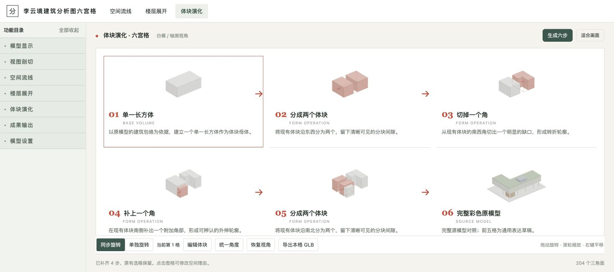

# 李云境建筑分析图六宫格

**作者：李云境。** 把六张建筑分析图，做成六个可旋转、可保存、可导出的阶段模型。



## 下载完整复现包

**[点击下载：李云境建筑分析图六宫格（完整 ZIP）](李云境建筑分析图六宫格_20261029.zip?raw=true)**

压缩包内有完整源码、通用 Skill、离线网页模板、教学模型、启动器、验收清单和第三方依赖。文件夹结构保留在 ZIP 中；请先解压，不要直接运行仓库首页文件。

## 最简单的使用方式

1. 下载上面的完整 ZIP 并解压。
2. 给有本地文件与执行能力的 AI 提供解压文件夹，以及你的**最终建筑模型**（优先未压缩 GLB）。
3. 让它先读 `START_HERE_FOR_AI.md` 和 `massing-six-grid/SKILL.md`，再执行。
4. **项目输入只需要第六格最终模型。** 前五格根据最终几何逆向推演；不要求你事先提供中间模型。

前五格是解释性推演，不代表恢复原作者的真实设计历史。必须适配本项目，不能只套通用切块、改几个标题就宣称成功。

## 页面与能力

- 三列两行，六格都是真实三维模型。
- 同步旋转、单独旋转、统一角度，控制区位于六格下方。
- 白底灰模、红色变化提示、四字三级折叠目录。
- 保存和恢复 JSON；导出中间阶段 GLB，可继续用于其他空间分析。
- 先轻量跑通，再加精度；工程面积、层高与功能语义另行核验。

## 本地教学试跑

安装 Python 3.9+，在**解压后的文件夹**中运行：

```sh
python3 massing-six-grid/scripts/launch.py --output "输出结果/教学试跑"
```

打开命令输出的完整地址，点击“生成六步”。教学模型用于验收页面，真实项目需由 AI 重新设计前五步规则。

## 实测与经验

已用 WorkBuddy 的 **DeepSeek-V4.1-Flash**，仅输入最终模型重建前五步。DeepSeek 完成实现，Codex 在现有 Chrome 补测：六格生成、同步/独立旋转、JSON 保存恢复、第三格 GLB 导出及重导入通过。

建筑推演逻辑仍需建筑师审核。一次测试不能证明所有模型均成功，Windows 尚未实测。

- [跨 AI 实测记录](04_DeepSeek跨AI复现记录.md)
- [关键要点与成功率策略](02_关键要点与成功率策略.md)
- [约 60 秒视频脚本](03_短视频脚本_约60秒.md)
- [验证记录](验证记录.json)

## 署名与来源

分享和改编请保留 **李云境建筑分析图六宫格**、作者 **李云境** 和本仓库链接。详见 [COPYRIGHT.md](COPYRIGHT.md)；第三方依赖保留原许可证。

本仓库不包含真实项目源模型，仅公开通用复现包、教学模型和方法说明。
